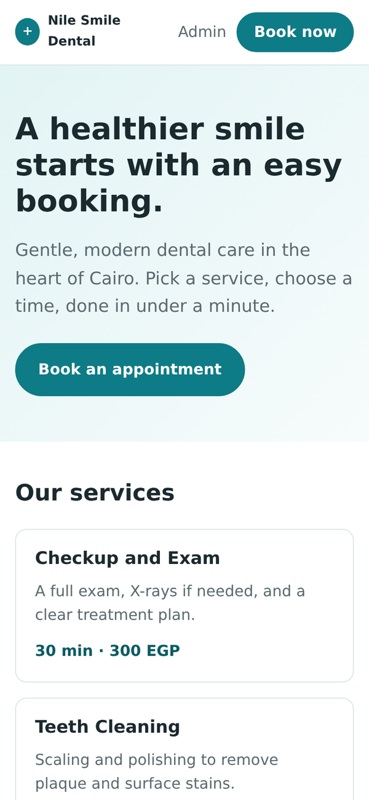
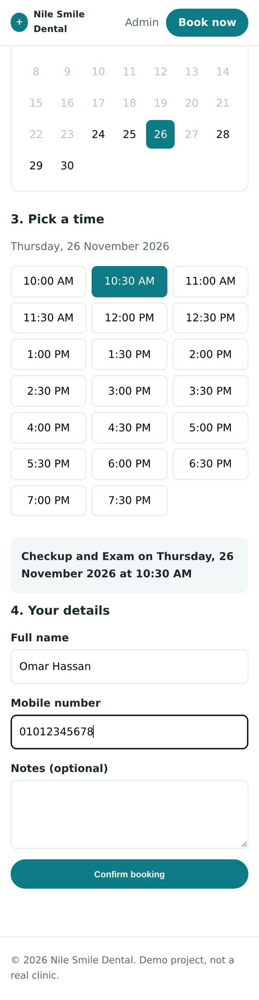
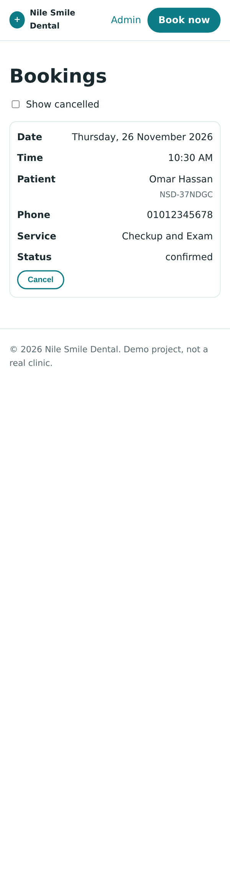

# Nile Smile Dental: online booking app

A booking app for a small dental clinic in Cairo. Patients pick a service, a date and a free time slot, and get a reference number. The clinic sees all bookings in one table and can cancel them.

**Live demo:** https://nile-smile-booking.vercel.app





_Screenshots to add: home, booking, admin (phone width works well)._

## The problem

Small clinics often take bookings by phone or WhatsApp. That means missed calls, double bookings and no overview. This app lets patients book themselves any time and stops two people getting the same slot.

## What it does

- Home page: services, prices, working hours, address.
- Booking: choose a service, pick a date, pick an available time, enter name and Egyptian mobile number.
- Confirmation page with a reference number (e.g. `NSD-687Z3H`).
- Admin page: all bookings sorted by date, cancel with confirmation, optional view of cancelled ones.
- Works on phones: the calendar, slot grid and admin table all adapt.

## How it works

- **React + Vite + React Router.** Each step is a real route, so back and refresh behave normally.
- **Slot logic is separate from the UI** (`src/lib/slots.js`) and covered by tests. A slot is free only if the whole treatment fits before closing and does not overlap another booking. Back-to-back bookings are allowed.
- **Dates are local `YYYY-MM-DD` strings**, not UTC timestamps, to avoid off-by-one-day bugs.
- **Availability is checked again on save**, so two tabs cannot book the same slot.
- **Egyptian phone validation** accepts `010...`, `+20 10...` and `0020...` formats and stores one normalized form.
- **Cancelling keeps the record** (status `cancelled`) and frees the slot.
- **Clinic content lives in one file** (`src/data/clinic.js`), so reusing the app for another clinic is mostly editing that file.

## Tradeoffs and what I would do next

- **Data is stored in the browser (localStorage).** Fine for a demo, but bookings are not shared between devices. A real version needs a backend (for example Supabase or a Node API) so the clinic sees patients' bookings.
- **The admin page has no login.** A real version needs authentication and server-side checks.
- **No SMS or WhatsApp reminders.** The obvious next feature for reducing no-shows.
- **One dentist, one chair.** Multiple dentists would mean availability per dentist.
- _Add your own: what you would change after talking to a real clinic._

## Run it locally

```bash
npm install
npm run dev      # http://localhost:5173
npm test         # slot and validation tests
npm run build
```

## Structure

```
src/
  pages/        Home, Booking, Confirmation, Admin
  components/   Calendar, SlotPicker, BookingForm, layout
  lib/          slots, dates, validation, storage, reference (+ tests)
  data/         clinic details and services
```
